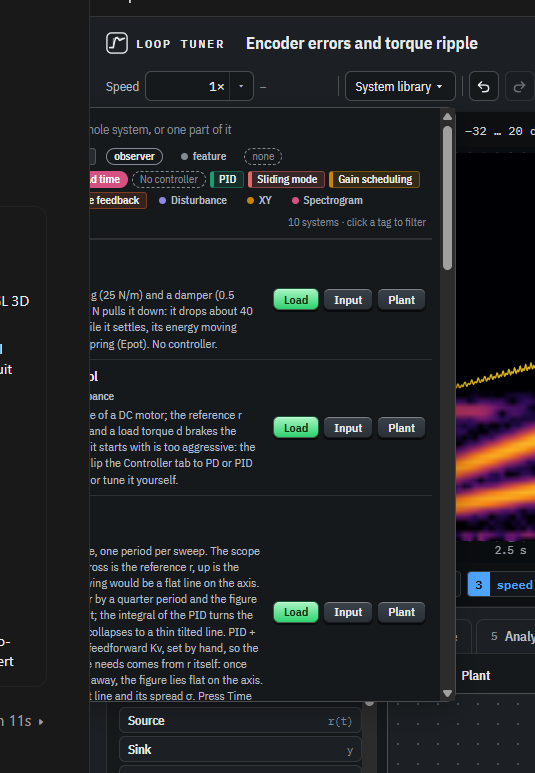

# Popovers cut off by the viewport (2026-10-25)

> Also, one thing that I've been seeing on mobile as well as here is that depending on the viewport, the system library might get cut off. Please make sure to fix that. So on mobile, you can't select anything because the system library is not it's not in a place where you can click it. So make sure that in general, the UI elements don't do that.
